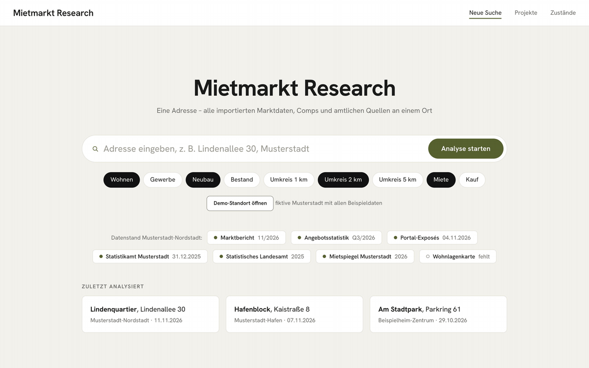
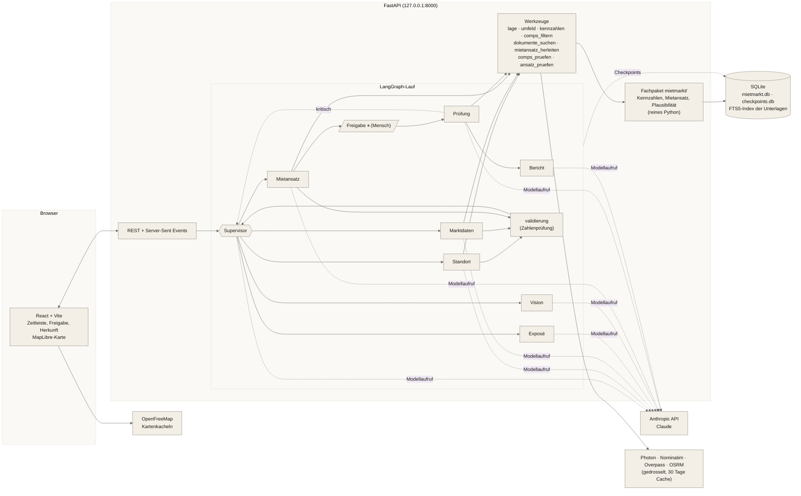
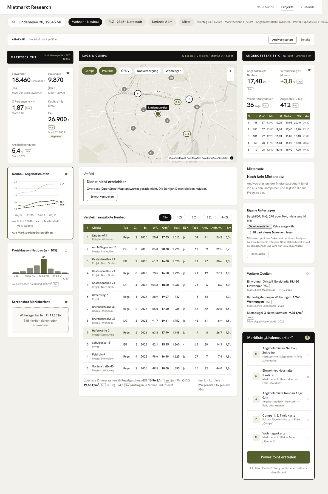

# Mietmarkt Research

Lokales Recherche-Tool, in dem KI-Agenten (LangGraph + Claude) für eine Adresse einen Neubau-Mietansatz herleiten. Jede Zahl rechnet Python, und jede Zahl ist bis zur Quelle belegt.



> Alle Daten im Repository sind synthetisch: fiktive „Musterstadt“, erfundene Adressen, Anbieter und Zahlen.
> Die Karte liegt nur als Kulisse über einer realen Stadt, damit Straßen und Bebauung sichtbar sind.

## Schnellstart (5 Minuten)

Voraussetzungen: Node.js 20+ und Python 3.12/3.13 oder [uv](https://docs.astral.sh/uv/) (installiert Python 3.13 selbst).

```bash
git clone <repo-url> && cd markt-research-tool
cp .env.example .env          # optional: ANTHROPIC_API_KEY eintragen, sonst läuft alles außer den Agenten
./start.sh                    # macOS/Linux; Windows: start.bat
```

1. Beim ersten Start richtet das Skript `backend/.venv` und die Frontend-Pakete ein, lädt den Demo-Datensatz und
   öffnet http://localhost:5173.
2. **„Demo-Standort öffnen“** klicken. Das öffnet das Lindenquartier in Musterstadt mit Comps, Marktbericht,
   Angebotsstatistik, Wohnungsmix und Karte. Fehlen die Demo-Daten, legt die App sie an; eigene Projekte bleiben erhalten.
3. **„Analyse starten“** (braucht den Schlüssel in `.env`). Die Agenten arbeiten sichtbar in der Zeitleiste. Am
   Mietansatz hält der Lauf an, bis du ihn annimmst, änderst oder ablehnst. Danach folgen Prüfung und Bericht
   (Export als Markdown oder PowerPoint).

macOS: `Mietmarkt Research.command` im Finder doppelklicken. Das startet die App und öffnet den Browser.
Die API-Dokumentation liegt unter http://localhost:8000/docs.

## Architektur



## Warum rechnet die KI nicht?

Sprachmodelle schreiben Zahlen, die plausibel aussehen, und das ist nicht dasselbe wie richtig. In einem Mietansatz
fällt ein vertauschtes Komma oder ein erfundener Median nicht auf, kostet aber Geld. Deshalb gilt:

- **Python rechnet, das Modell entscheidet.** Median, Quartile, €/m², Fortschreibung und Zu-/Abschläge rechnen
  Fachfunktionen in `backend/mietmarkt/`. Das Modell ruft sie als Werkzeuge auf und wählt Basis und begründete
  Anpassungen. Den Betrag rechnet der Code.
- **Jede Zahl hat eine Herkunft:** `import | manuell | ki | abgelesen | berechnet`, dazu Quelle oder Rechenweg. Ein
  Klick auf das Kennzeichen in der Oberfläche zeigt beides.
- **Freie Zahlen fallen auf.** Der Knoten `validierung` markiert jede Zahl einer Agenten-Antwort, die in keinem
  Werkzeugergebnis steht. Im Bericht darf das Modell Zahlen nur als Platzhalter `{{wert:ID}}` schreiben, Python
  setzt Wert und Fußnote ein. Was danach noch frei ist, wird zu `[?]`.
- **Der Mensch gibt frei.** Der Mietansatz wirkt erst nach „Annehmen“ oder „Ändern“. Geänderte Werte tragen die
  Herkunft `manuell`.

## Kosten pro Lauf (gemessen)

Gemessen am 23.11.2026 auf dem Demo-Standort mit `skripte/lauf-gif.mjs` (der Lauf aus dem GIF oben):
Startseite → Demo → Analyse → Freigabe annehmen → Prüfung → Bericht.

| Modelle | Token | Kosten |
|---|---|---|
| `MODELL_STARK=claude-sonnet-5-5`, `MODELL_SCHNELL=claude-haiku-5-5` (Standard) | 95.941 | **0,18 €** |

Gut die Hälfte davon entfiel auf den Mietansatz-Agenten (0,10 €). Die App rechnet die Kosten aus `usage_metadata` mit
der Preistabelle in `backend/mietmarkt/agenten/kosten.py` und dem Kurs `KI_EUR_JE_USD` (0,86). Overpass war
während der Messung nicht erreichbar, deshalb fehlte das Umfeld (der Lauf meldet das als Befund).
Ein Lauf bricht ab, sobald er `KI_BUDGET_EUR_PRO_LAUF` erreicht (Standard 0,50 €). Ohne Schlüssel entstehen keine Kosten.

## Bedienung

- **Startseite:** Adresse tippen, mit Pfeiltasten wählen, Enter. Jede Adresse in Deutschland ist suchbar; Marktdaten
  gibt es nur, wo importierte oder Demo-Daten im Umkreis liegen.
- **Analyse:** Stern = auf die Merkliste (Merkliste per Maus oder Tastatur sortieren). Kartenebenen über die Pills;
  Klick auf eine Tabellenzeile hebt den Comp auf der Karte hervor. Eigene Unterlagen (PDF, Bild, Text) hochladen,
  das Häkchen „KI darf lesen“ ist standardmäßig aus.
- **Zustände:** `/zustaende` zeigt Laden, Leer, Fehler und Teildaten.



## API

| Endpunkt | Liefert |
|---|---|
| `GET /api/adressen/vorschlaege?q=…` | Adressvorschläge (Photon), ab 3 Zeichen, mit Attribution |
| `POST /api/projekte` | Projekt aus einem gewählten Vorschlag anlegen (Adresse über Nominatim) |
| `GET /api/projekte/{id}/umfeld` | ÖPNV, Supermärkte, Schulen, Kitas, Ärzte im Umkreis 1 km mit Wegezeiten |
| `GET /api/projekte` | alle Projekte, zuletzt analysierte zuerst |
| `POST /api/demo` | Demo-Standort öffnen → `{projekt_id}`; legt die Demo-Daten nur an, wenn sie fehlen |
| `GET /api/projekte/{id}` | ein Projekt mit Datenstand je Quelle |
| `GET /api/projekte/{id}/comps` | Comps mit €/m², Tagen online, Anfragen je Monat, Luftlinie – je als Wert mit Rechenweg |
| `GET /api/projekte/{id}/kennzahlen` | Marktkennzahlen mit Herkunft, Comps-Zusammenfassung, Preisklassen-Auswertung |
| `POST /api/projekte/{id}/laeufe` | Agenten-Lauf anlegen → `{lauf_id}`; 503 „KI nicht konfiguriert“ ohne Schlüssel |
| `GET /api/laeufe/{lauf_id}/ereignisse` | Lauf ausführen bzw. fortsetzen, Ereignisse als Server-Sent Events (siehe unten) |
| `POST /api/laeufe/{lauf_id}/freigabe` | Mietansatz freigeben: `{aktion: annehmen \| aendern \| ablehnen, aenderungen?: {regel_eg?, dg?}, kommentar?}`; streamt weiter |
| `POST /api/laeufe/{lauf_id}/antwort` | Rückfrage des Supervisors beantworten: `{antwort}`; streamt weiter |
| `POST /api/projekte/{id}/dokumente` | Eigene Unterlage hochladen (Formular: `datei`, `ki_freigabe`): PDF, PNG/JPG, Text; höchstens 10 MB (Bilder 5 MB), Typ am Inhalt erkannt; Ablage unter `daten/uploads/` |
| `GET /api/laeufe/{lauf_id}/bericht.md` / `.pptx` | Bericht eines fertigen Laufs als Markdown oder PowerPoint |
| `GET /api/gesundheit` | Lebenszeichen; `ki: true/false`, ob ein Anthropic-Schlüssel eingetragen ist |

Jede Zahl kommt als `{wert, einheit, herkunft, quelle_id, rechenweg_text}`; `herkunft` ist `import | manuell | ki | abgelesen | berechnet`.

## KI-Agenten (LangGraph)

Ein Lauf ist ein LangGraph-Graph in `backend/mietmarkt/agenten/`:
`supervisor → Agent ⇄ Werkzeuge → validierung → supervisor → … → mietansatz → freigabe ⏸ → pruefung → bericht → Ende`.
„Ablehnen“ bei der Freigabe und ein kritischer Prüfbefund führen zurück zum Supervisor. Stellt der Supervisor eine
Rückfrage, hält der Lauf an (`rueckfrage ⏸`); die Antwort geht an den Supervisor, der neu entscheidet. Zahlen aus
Antworten des Nutzers gelten bei der Zahlenprüfung als belegt.

| Agent | Modell (`.env`) | Werkzeuge |
|---|---|---|
| Supervisor | `MODELL_STARK` (Standard `claude-sonnet-5-5`) | keine; entscheidet per strukturierter Ausgabe, wer als Nächstes dran ist |
| Standort | `MODELL_SCHNELL` (Standard `claude-haiku-5-5`) | `lage` (Adresse und Koordinaten aus der Datenbank, kein Geokodieren), `umfeld` |
| Marktdaten | `MODELL_SCHNELL` | `kennzahlen`, `comps_filtern` |
| Mietansatz | `MODELL_STARK` | `kennzahlen`, `mietansatz_herleiten` (rechnet; Basis `regel_eg` oder `dg`; Zu-/Abschläge des Modells tragen Herkunft `ki`) |
| Prüfung | `MODELL_STARK` | `comps_pruefen` (unter 5 Comps, älter als 12 Monate, Ausreißer per 1,5 × IQR), `ansatz_pruefen` (Abweichung > 15 % zu Median, Ø Regel/EG, Kennzahlen der Angebotsstatistik); der Code ruft beide immer auf, das Modell vergibt nur den Schweregrad `hinweis \| warnung \| kritisch` |
| Bericht | `MODELL_STARK` | keine; schreibt Lage, Markt, Mietansatz, Risiken mit Platzhaltern `{{wert:ID}}` |

- **Zahlen:** Werkzeuge rufen nur Fachfunktionen auf. Der Knoten `validierung` markiert jede Zahl einer Agenten-Antwort,
  die in keinem Werkzeugergebnis und nicht in den Projektdaten steht (Herkunft `ki`, Warnhinweis); ebenso Begründung,
  Auftrag und Rückfrage des Supervisors.
- **Fachregeln Mietansatz:** Der Haupt-Mietansatz geht immer von Regelgeschoss/EG aus. DG ist eine getrennte
  Herleitung mit DG-Basis, nie ein Zuschlag (im Code geprüft). Jeder Zu-/Abschlag nennt einen belegten Unterschied
  zwischen Projekt und Comps; ohne belegten Unterschied kein Merkmal (Prompt-Regel, nicht maschinell prüfbar).
- **Leitplanken im Code:** „fertig“ ohne Rückfrage erst, wenn alle drei Agenten erledigt sind (Mietansatz erst mit
  Freigabe), Mietansatz erst nach Standort und Marktdaten, Zu-/Abschläge höchstens ±10 €/m² und höchstens 10 je
  Herleitung (Name 80, Begründung 500 Zeichen), höchstens 8 Supervisor-Runden (danach Abbruch ohne Bericht, die
  siebte Runde wird nicht mehr bezahlt).
- **Mietansatz:** je Basis eine Herleitung (`regel_eg` Pflicht, `dg` Pflicht, wenn der Wohnungsmix DG-Wohnungen hat;
  fehlt eine, schickt der Code den Agenten einmal mit Hinweis zurück). Jede Herleitung wird bis zum
  Vermarktungsstart fortgeschrieben: Ansatz × (1 + g)^(Monate/12), volle Kalendermonate ab Stichtag; g aus dem
  Projekt (`mietwachstum_pa`), sonst `MIETWACHSTUM_PA` in `.env` (Standard 0,02). Geprüft wird der Ansatz zum Stichtag.
- **Freigabe (Human-in-the-Loop):** Nach dem Mietansatz hält der Lauf an (`interrupt()`); der Vorschlag (Herleitungen
  je Basis, Zu-/Abschläge, Begründung) kommt als Ereignis `wartet_auf_freigabe`. `annehmen` übernimmt ihn, `aendern` rechnet mit
  neuer Basis bzw. neuen Zu-/Abschlägen neu (geänderte Werte Herkunft `manuell`, unveränderte bleiben `ki`),
  `ablehnen` (Kommentar Pflicht) schickt den Kommentar über den Supervisor an den Mietansatz-Agenten. Der angehaltene
  Lauf überlebt einen Neustart der App.
- **Prüfung:** Ausgefallene Dienste meldet der Code selbst als Befund `dienst` (Overpass weg → warnung, kein
  Umfeld; OSRM weg → hinweis, nur Luftlinie), damit sie unter Risiken stehen können. Bei einem kritischen Befund verfallen Freigabe und Mietansatz, es geht zum Supervisor zurück. Nach
  2 Prüfrunden geht es auch bei „kritisch“ zum Bericht; der Befund steht dann unter Risiken.
- **Bericht:** Das Modell schreibt je Abschnitt Sätze mit Belegen (Katalog-ID, `befund:N`, `ergebnis:<agent>`,
  `freigabe`, `projekt`; unter Risiken nur `befund:N` und Katalog-IDs); Sätze ohne gültigen Beleg streicht Python. Zahlwörter („drei“, „zwölf“, „Hälfte“) zählen
  wie Ziffern. Entfernungen stehen gerundet im Text („rd. 230 m“), die Fußnote nennt den genauen Wert. Gleiche
  Fußnoten werden zusammengelegt. Unter „Methoden“ ([M1] …) stehen nur Quellen- und Verfahrenshinweise (OSRM,
  Haversine, Quartile inklusiv, Grenze ± 15 %); Formeln bleiben vollständig in der Fußnote. Nach Präpositionen steht
  die Einheit im Dativ („bei 36 Tagen“). Das Modell sieht einen Werte-Katalog (jeder Wert mit Herkunft aus Werkzeugergebnissen und der
  freigegebenen Herleitung) und darf Zahlen nur als `{{wert:ID}}` schreiben. Python setzt Wert, Einheit und Fußnote
  (Herkunft, Rechenweg bzw. Quelle) ein. Enthält der Entwurf freie Zahlen, bekommt das Modell einmal einen
  Korrekturauftrag mit genau diesen Zahlen (`bericht.korrektur`, eigener Knoten `bericht_korrektur`); was danach
  noch frei ist, wird zu `[?]` und als Markierung gemeldet. Zahlen rundet `de()` kaufmännisch; importierte
  Kennzahlen erscheinen mit ihren eigenen Nachkommastellen. Der Markdown-Export maskiert nur, was wirken würde (Links,
  Bilder, HTML, Backticks) in Modell- und Importtext und erklärt `[?]` sowie gestrichene Aussagen.
  Export als Markdown und PowerPoint (`backend/mietmarkt/export.py`, Sand/Stein/Oliv, ohne Logo).
- **Unterlagen (RAG):** Hochgeladene Texte werden seitenweise in Abschnitte von rund 800 Zeichen mit Überlappung
  geteilt und in SQLite FTS5 indexiert (Tabelle `abschnitt`, kein Embedding-Dienst). Das Werkzeug
  `dokumente_suchen` (Standort, Marktdaten, Mietansatz) liefert Datei, Seite und Ausschnitt; Aussagen daraus
  belegen die Agenten mit `[Quelle: Datei, S. X]`. Die Prüfung meldet im Code Sätze, die erkennbar aus Treffern
  stammen (vier gleiche Wörter in Folge oder eine Zahl, die nur dort steht), aber keine Fundstelle haben, und
  Fundstellen, die in keinem Treffer vorkommen (Befund `fundstelle`).
- **Exposé-Agent** (`MODELL_SCHNELL`): Ein Parser liest Wohnfläche, Kaltmiete, Zimmer, Baujahr und Ausstattung
  (Herkunft `import`, Seite). Nur leer gebliebene Felder ergänzt das Modell mit Seite und wörtlichem Zitat; Python
  prüft das Zitat am Text und die Zahl im Zitat, sonst wird die Ergänzung verworfen (Herkunft `ki`).
- **Vision-Agent** (`MODELL_STARK`): liest Tabellen und Diagramme aus hochgeladenen Bildern; jeder Wert trägt
  Herkunft `abgelesen` und den Bildausschnitt `[x, y, Breite, Höhe]`; Werte aus Diagrammen erscheinen als „rd.“.
  Werte ohne Zahl oder mit Ausschnitt außerhalb des Bildes fallen heraus. Kein Abruf von Webseiten.
- **Supervisor:** Mit freigegebenen Unterlagen sind Exposé- (PDF/Text) bzw. Vision-Agent (Bilder) Pflicht vor dem
  Mietansatz; ohne passende Unterlagen werden sie nicht aufgerufen.
- **Kosten:** Token je Aufruf aus `usage_metadata` × Preistabelle (`agenten/kosten.py`) × `KI_EUR_JE_USD`. Erreicht ein
  Lauf `KI_BUDGET_EUR_PRO_LAUF` (Standard 0,50 €), startet kein weiterer Modellaufruf; der letzte Aufruf kann das
  Budget also noch etwas überschreiten. Modelle ohne Eintrag in der Preistabelle werden vor jedem Aufruf abgelehnt.
  Ein Gesamtlimit über alle Läufe setzt man am einfachsten als Ausgabelimit in der Anthropic Console.
- **Wiederaufnahme:** Nach jedem Schritt sichert der Checkpointer den Zustand in `daten/checkpoints.db`
  (thread_id = Lauf-ID). Ruft man die Ereignisse eines unterbrochenen Laufs erneut ab, geht er dort weiter. Ein
  zweiter Abruf, während der Lauf noch läuft, bekommt 409. Ist ein Lauf beendet, steht sein Endstand in der Tabelle
  `lauf`, der Checkpoint wird gelöscht; der Endstand lässt sich auch ohne Schlüssel abrufen.
- **Ereignisse (SSE):** `agent_gestartet`, `werkzeugaufruf`, `werkzeugergebnis`, `text`, `agent_fertig`, `kosten`,
  `rueckfrage`, `wartet_auf_freigabe` bzw. `wartet_auf_antwort` (Strom endet, Lauf pausiert), `freigabe`, `antwort`,
  `pruefung` (Befunde, `zurueck`), `bericht`, `abbruch`, `fehler`, zum Schluss `fertig` mit Status
  `fertig | abgebrochen`, Ergebnissen, Rückfragen mit Antworten, Freigabe, Bericht und Gesamtkosten.

## Tests

```bash
cd backend && .venv/bin/pytest -q && .venv/bin/ruff check .
cd backend && .venv/bin/pytest -m live -s   # echter kurzer Lauf mit Claude (kostet Geld, braucht ANTHROPIC_API_KEY)
cd frontend && npm test && npx tsc --noEmit
cd frontend && node skripte/aufnahme.mjs <ordner> name=/pfad   # Screenshots (App muss laufen)
cd frontend && node skripte/lauf.mjs                            # kompletter Lauf im Browser mit Fake-Modell (kostenlos)
cd frontend && node skripte/lauf-gif.mjs ../docs/screenshots/lauf.gif   # echter Lauf als GIF (kostet Cent, App muss laufen)
```

## Wo ändere ich was

| Was | Wo |
|---|---|
| Farben, Schriften, Abstände, Layout | `frontend/src/stil/app.css` (Tokens ganz oben) |
| Startseite / Analyse / Zustände | `frontend/src/seiten/` |
| Bausteine (Tabellen, Freigabe, Herleitung, Kopf, Agentenleiste) | `frontend/src/komponenten/` |
| Karte (Stil, Ringe, Marker) | `frontend/src/komponenten/kartenstil.ts`, `Karte.tsx` |
| Diagramme | `frontend/src/komponenten/Diagramme.tsx` |
| Datenmodell (Projekt, Quelle, Comp, Marktkennzahl, Wert mit Herkunft) | `backend/mietmarkt/modelle.py` |
| Kennzahlen (€/m², Median, Quartile, Ø flächengewichtet, Anfragen je Monat) | `backend/mietmarkt/kennzahlen.py` |
| Entfernung, Comp-Filter, Mietansatz-Kette | `backend/mietmarkt/geo/distanz.py`, `comps.py`, `mietansatz.py` |
| CSV/XLSX-Import von Comps | `backend/mietmarkt/importe.py` |
| Demo-Datensatz (inkl. Wohnungsmix, Vermarktungsstart, g) | `backend/mietmarkt/demo/musterstadt.yaml` |
| Mietwachstum für Projekte ohne eigenen Wert | `.env`: `MIETWACHSTUM_PA` |
| API-Endpunkte | `backend/api/main.py` |
| Externe Geodienste (URLs, Drossel, Cache), Umfeld-Auswertung | `backend/mietmarkt/geo/` |
| Agenten: Prompts, Graph, Leitplanken | `backend/mietmarkt/agenten/graph.py` |
| Agenten-Werkzeuge / Modellpreise / Zahlenprüfung | `backend/mietmarkt/agenten/werkzeuge.py`, `kosten.py`, `pruefung.py` |
| Plausibilitätsregeln (Mindestzahl, Alter, IQR, 15 %) | `backend/mietmarkt/plausibilitaet.py` |
| Platzhalter im Bericht, Export Markdown/PowerPoint | `backend/mietmarkt/agenten/bericht.py`, `backend/mietmarkt/export.py` |
| Modelle, Budget, Schlüssel | `.env` (Vorlage `.env.example`), gelesen in `backend/mietmarkt/konfig.py` |
| Platzhalter (Merkliste-Beispiele) | `frontend/src/daten/platzhalter.ts` |

## Externe Dienste

Alle Anfragen laufen über das Backend (nicht direkt aus dem Browser), mit dem User-Agent
`MietmarktResearch/0.1 (privates Projekt)` und `Accept-Language: de`. Antworten werden 30 Tage in der Tabelle `geocache`
(`daten/mietmarkt.db`) zwischengespeichert; dieselbe Anfrage geht also nur einmal hinaus, auch wenn sie zweimal
gleichzeitig gestellt wird. Ältere Einträge werden gelöscht, fehlerhafte Antworten nie gespeichert.

| Dienst | Wofür | Was gesendet wird | Grenzen |
|---|---|---|---|
| Photon (`photon.komoot.io`) | Adressvorschläge beim Tippen | der getippte Suchtext (ab 3 Zeichen, 300 ms nach dem letzten Tastendruck) | nur Deutschland (bbox), max. 5 Treffer, gedrosselt (2 Anfragen/s) |
| Nominatim (`nominatim.openstreetmap.org`) | endgültige Adresse beim Anlegen eines Projekts, Rückwärtssuche | gewählte Adresse bzw. deren Koordinaten | höchstens 1 Anfrage pro Sekunde, nie für die Autovervollständigung (Nutzungsrichtlinie) |
| Overpass (`overpass-api.de`) | Umfeld: ÖPNV, Supermärkte, Schulen, Kitas, Ärzte | Koordinaten des Standorts, Radius 1.000 m | gedrosselt (1 Anfrage/s), Rechenzeit 20 s, Timeout 25 s je Server; Ersatzserver nur, wenn in `OVERPASS_URLS` eingetragen; Umfeld je Projekt 30 Tage gespeichert (Fußnote nennt das Abrufdatum) |
| OSRM (`routing.openstreetmap.de`, FOSSGIS) | Wegezeiten zu Fuß und mit dem Rad | Koordinaten von Standort und bis zu 3 Zielen je Kategorie | gedrosselt; fällt der Dienst aus oder ist ein Ziel nicht routbar, gilt die Luftlinie (Kennzeichnung „Luftlinie“); der Rechenweg nennt das Abrufdatum |
| OpenFreeMap (`tiles.openfreemap.org`) | Kartenkacheln und Schriften der Karte | Kachelkoordinaten des sichtbaren Ausschnitts (direkt aus dem Browser) | – |

Warum nicht `router.project-osrm.org`: Der OSRM-Demo-Server rechnet nur mit dem Autoprofil und liefert für „foot“ die
Autozeit. Die FOSSGIS-Server sprechen dieselbe OSRM-API mit echten Fuß- und Radprofilen (`backend/mietmarkt/geo/dienste.py`).

Overpass-Ersatzserver nur auf Wunsch: Standardmäßig steht in `OVERPASS_URLS` nur `overpass-api.de`. Weitere Server
(z. B. `https://overpass.kumi.systems/api/interpreter`) trägt man selbst in `.env` ein; sie bekommen dann die
Projektkoordinaten. Fällt der erste aus, fragt die App den nächsten, die Fußnote nennt den Server, der geliefert hat.
Ohne Ersatzserver zeigt die App bei Überlast „Dienst nicht erreichbar“. Ein erfolgreiches Umfeld liegt je Projekt
30 Tage in der Tabelle `umfeldcache`, ein Lauf braucht Overpass dann nicht.

Der Browser darf nur Adressen in Deutschland übergeben (Koordinaten-, Längen- und NaN-Prüfung, sonst 422).
Fällt ein Dienst aus, antwortet die API mit 503; die Oberfläche zeigt „Dienst nicht erreichbar“, der Rest bleibt nutzbar.
Marktdaten (Comps, Marktberichte, Angebotsstatistiken) gehen an keinen dieser Dienste. Demo-Daten erscheinen nur bei Demo-Projekten, nie bei
echten Adressen.

## Datenschutz: was an wen geht

- **Lokal:** Uploads, Datenbank, Checkpoints und Cache liegen in `daten/` (nicht im Repository). Das Backend lauscht
  nur auf 127.0.0.1.
- **Geodienste** (Tabelle oben) bekommen nur Suchtext, Adressen und Koordinaten, nie Marktdaten.
- **An Anthropic geht nur etwas, wenn du einen Lauf startest:**
  - Projektdaten: Name, Adresse, PLZ, Ort, Ortsteil, Koordinaten, Segment, Umkreis, Stichtag, Vermarktungsstart,
    Mietwachstum und Wohnungsmix,
  - die Werkzeugergebnisse (Comps, Kennzahlen, Umfeld, Herleitungen, Prüfergebnisse) und die Antworten der Agenten,
  - deine Antworten auf Rückfragen und dein Kommentar beim Ablehnen eines Mietansatzes,
  - Dateinamen freigegebener Unterlagen und die Anzahl zurückgehaltener Einträge.
- **Importierte Portal-Daten gehen standardmäßig nicht an Anthropic.** Comps und Kennzahlen mit Herkunft `import`
  (Marktberichte, Angebotsstatistiken, Portal-Exporte) dürfen nach ihrer Lizenz oft nicht an Dritte. Ohne Freigabe
  sehen die Agenten nur Demo-Daten, selbst erfasste Werte (`manuell`) und das Umfeld aus OpenStreetMap. Freigabe auf
  eigene Verantwortung: `KI_PORTALDATEN_SENDEN=true`.
- **Hochgeladene Unterlagen gehen nur mit Häkchen „KI darf lesen“ an Anthropic** (gilt auch im Demo-Projekt und bei
  `KI_PORTALDATEN_SENDEN=true`). Mit Häkchen gehen Suchtreffer (Textausschnitte), der Text von Exposés mit leeren
  Feldern und Bilder selbst an Anthropic.
- Der API-Schlüssel steht nur in `.env` (nie im Code, in Logs oder im Browser). Ein Gesamtlimit über alle Läufe
  setzt man am einfachsten als Ausgabelimit in der Anthropic Console.

## Grenzen des Projekts

- **Kein Datenabruf aus Portalen.** Marktberichte, Angebotsstatistiken und Exposés kommen nur aus Dateien, die du
  selbst importierst, oder aus dem Demo-Datensatz. Die App lädt nichts von Immobilienportalen. Ein Import-Endpunkt für
  Comps-Dateien fehlt noch (die Fachfunktion `importe.py` ist da).
- **Kein Gutachten.** Der Mietansatz ist eine nachvollziehbare Herleitung aus den vorhandenen Daten, keine
  Bewertung nach ImmoWertV. Ob ein Zu-/Abschlag fachlich trägt, prüft der Code nur formal (Betrag, Anzahl, Beleg);
  die Begründung beurteilst du bei der Freigabe.
- **Prompt-Regeln sind nicht maschinell prüfbar**, etwa „kein Merkmal ohne belegten Unterschied“. Leitplanken im Code
  begrenzen Beträge, Runden und Budget.
- **Externe Dienste sind öffentlich und manchmal überlastet** (Overpass). Die App meldet Ausfälle als Befund und
  rechnet dann mit Luftlinie oder ohne Umfeld.
- **Einzelnutzer, lokal.** Keine Anmeldung, keine Mandanten. Nicht für den Betrieb im Netz gedacht.
- **Nur Deutschland, nur Miete/Wohnen-Neubau** fachlich ausgearbeitet. Filter wie Gewerbe oder Kauf sind Oberfläche.
- Offene Punkte stehen in [`CHANGELOG.md`](CHANGELOG.md) und [`docs/fortschritt.md`](docs/fortschritt.md).

## Lizenz

[MIT](LICENSE). Kartendaten und Umfeld © OpenStreetMap-Mitwirkende (ODbL), Kacheln OpenFreeMap / OpenMapTiles,
Routing FOSSGIS. Schrift: Hanken Grotesk (SIL Open Font License).
