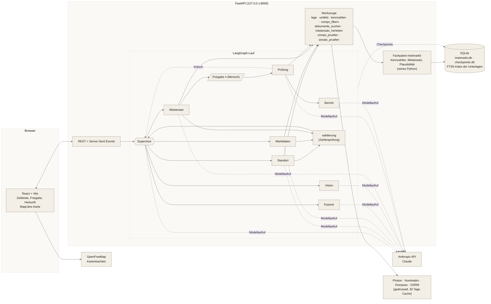

# Mietmarkt Research

Lokales Recherche-Tool, in dem KI-Agenten (LangGraph + Claude) für eine Adresse einen Neubau-Mietansatz herleiten. Jede Zahl rechnet Python, und jede Zahl ist bis zur Quelle belegt.


> Alle Daten im Repository sind synthetisch: fiktive „Musterstadt“, erfundene Adressen, Anbieter und Zahlen.
> Die Karte liegt nur als Kulisse über einer realen Stadt, damit Straßen und Bebauung sichtbar sind.

## Schnellstart (5 Minuten)

Voraussetzungen: Node.js 20+ und Python 3.12/3.13 oder [uv](https://docs.astral.sh/uv/) (installiert Python 3.13 selbst).

```bash
git clone https://github.com/umalanyali/mietmarkt-research-tool.git
cd mietmarkt-research-tool
cp .env.example .env          # optional: ANTHROPIC_API_KEY eintragen, sonst läuft alles außer den Agenten
./start.sh                    # macOS/Linux; Windows: start.bat
```

1. Beim ersten Start richtet das Skript `backend/.venv` und die Frontend-Pakete ein, lädt den Demo-Datensatz und
   öffnet http://localhost:5173.
2. **„Demo-Standort öffnen“** klicken. Das öffnet das Lindenquartier in Musterstadt mit Comps, Marktbericht,
   Angebotsstatistik, Wohnungsmix und Karte. Fehlen die Demo-Daten, legt die App sie an; eigene Projekte bleiben erhalten.
3. **„Analyse starten“** (braucht den Schlüssel in `.env`). Die Agenten arbeiten sichtbar in der Zeitleiste. Am
   Mietansatz hält der Lauf an, bis du ihn annimmst, änderst oder ablehnst. Danach folgen Prüfung und Bericht
   (Export als Markdown oder PowerPoint).

macOS: `Mietmarkt Research.command` im Finder doppelklicken. Das startet die App und öffnet den Browser.
Die API-Dokumentation liegt unter http://localhost:8000/docs.

## Architektur



Details zu API, Agenten, Leitplanken, SSE-Ereignissen, externen Diensten und „Wo ändere ich was“:
**[docs/architektur.md](docs/architektur.md)**.

## Warum rechnet die KI nicht?

Sprachmodelle schreiben Zahlen, die plausibel aussehen, und das ist nicht dasselbe wie richtig. In einem Mietansatz
fällt ein vertauschtes Komma oder ein erfundener Median nicht auf, kostet aber Geld. Deshalb gilt:

- **Python rechnet, das Modell entscheidet.** Median, Quartile, €/m², Fortschreibung und Zu-/Abschläge rechnen
  Fachfunktionen in `backend/mietmarkt/`. Das Modell ruft sie als Werkzeuge auf und wählt Basis und begründete
  Anpassungen. Den Betrag rechnet der Code.
- **Jede Zahl hat eine Herkunft:** `import | manuell | ki | abgelesen | berechnet`, dazu Quelle oder Rechenweg. Ein
  Klick auf das Kennzeichen in der Oberfläche zeigt beides.
- **Freie Zahlen fallen auf.** Der Knoten `validierung` markiert jede Zahl einer Agenten-Antwort, die in keinem
  Werkzeugergebnis steht. Im Bericht darf das Modell Zahlen nur als Platzhalter `{{wert:ID}}` schreiben, Python
  setzt Wert und Fußnote ein. Was danach noch frei ist, wird zu `[?]`.
- **Der Mensch gibt frei.** Der Mietansatz wirkt erst nach „Annehmen“ oder „Ändern“. Geänderte Werte tragen die
  Herkunft `manuell`.

## Kosten pro Lauf (gemessen)

Gemessen am 23.11.2026 auf dem Demo-Standort mit `skripte/lauf-gif.mjs` (der Lauf aus dem GIF oben):
Startseite → Demo → Analyse → Freigabe annehmen → Prüfung → Bericht.

| Modelle | Token | Kosten |
|---|---|---|
| `MODELL_STARK=claude-sonnet-5-5`, `MODELL_SCHNELL=claude-haiku-5-5` (Standard) | 95.941 | **0,18 €** |

Gut die Hälfte davon entfiel auf den Mietansatz-Agenten (0,10 €). Die App rechnet die Kosten aus `usage_metadata` mit
der Preistabelle in `backend/mietmarkt/agenten/kosten.py` und dem Kurs `KI_EUR_JE_USD` (0,86). Overpass war
während der Messung nicht erreichbar, deshalb fehlte das Umfeld (der Lauf meldet das als Befund).
Ein Lauf bricht ab, sobald er `KI_BUDGET_EUR_PRO_LAUF` erreicht (Standard 0,50 €). Ohne Schlüssel entstehen keine Kosten.

## Bedienung

- **Startseite:** Adresse tippen, mit Pfeiltasten wählen, Enter. Jede Adresse in Deutschland ist suchbar; Marktdaten
  gibt es nur, wo importierte oder Demo-Daten im Umkreis liegen.
- **Analyse:** Stern = auf die Merkliste (Merkliste per Maus oder Tastatur sortieren). Kartenebenen über die Pills;
  Klick auf eine Tabellenzeile hebt den Comp auf der Karte hervor. Eigene Unterlagen (PDF, Bild, Text) hochladen,
  das Häkchen „KI darf lesen“ ist standardmäßig aus.
- **Zustände:** `/zustaende` zeigt Laden, Leer, Fehler und Teildaten.


## Tests

```bash
cd backend && .venv/bin/pytest -q && .venv/bin/ruff check .
cd backend && .venv/bin/pytest -m live -s   # echter kurzer Lauf mit Claude (kostet Geld, braucht ANTHROPIC_API_KEY)
cd frontend && npm test && npx tsc --noEmit
cd frontend && node skripte/aufnahme.mjs <ordner> name=/pfad   # Screenshots (App muss laufen)
cd frontend && node skripte/lauf.mjs                            # kompletter Lauf im Browser mit Fake-Modell (kostenlos)
cd frontend && node skripte/lauf-gif.mjs ../docs/screenshots/lauf.gif   # echter Lauf als GIF (kostet Cent, App muss laufen)
```

## Datenschutz: was an wen geht

- **Lokal:** Uploads, Datenbank, Checkpoints und Cache liegen in `daten/` (nicht im Repository). Das Backend lauscht
  nur auf 127.0.0.1.
- **Geodienste** ([Tabelle](docs/architektur.md#externe-dienste)) bekommen nur Suchtext, Adressen und Koordinaten, nie Marktdaten.
- **An Anthropic geht nur etwas, wenn du einen Lauf startest:**
  - Projektdaten: Name, Adresse, PLZ, Ort, Ortsteil, Koordinaten, Segment, Umkreis, Stichtag, Vermarktungsstart,
    Mietwachstum und Wohnungsmix,
  - die Werkzeugergebnisse (Comps, Kennzahlen, Umfeld, Herleitungen, Prüfergebnisse) und die Antworten der Agenten,
  - deine Antworten auf Rückfragen und dein Kommentar beim Ablehnen eines Mietansatzes,
  - Dateinamen freigegebener Unterlagen und die Anzahl zurückgehaltener Einträge.
- **Importierte Portal-Daten gehen standardmäßig nicht an Anthropic.** Comps und Kennzahlen mit Herkunft `import`
  (Marktberichte, Angebotsstatistiken, Portal-Exporte) dürfen nach ihrer Lizenz oft nicht an Dritte. Ohne Freigabe
  sehen die Agenten nur Demo-Daten, selbst erfasste Werte (`manuell`) und das Umfeld aus OpenStreetMap. Freigabe auf
  eigene Verantwortung: `KI_PORTALDATEN_SENDEN=true`.
- **Hochgeladene Unterlagen gehen nur mit Häkchen „KI darf lesen“ an Anthropic** (gilt auch im Demo-Projekt und bei
  `KI_PORTALDATEN_SENDEN=true`). Mit Häkchen gehen Suchtreffer (Textausschnitte), der Text von Exposés mit leeren
  Feldern und Bilder selbst an Anthropic.
- Der API-Schlüssel steht nur in `.env` (nie im Code, in Logs oder im Browser). Ein Gesamtlimit über alle Läufe
  setzt man am einfachsten als Ausgabelimit in der Anthropic Console.

## Grenzen des Projekts

- **Kein Datenabruf aus Portalen.** Marktberichte, Angebotsstatistiken und Exposés kommen nur aus Dateien, die du
  selbst importierst, oder aus dem Demo-Datensatz. Die App lädt nichts von Immobilienportalen. Ein Import-Endpunkt für
  Comps-Dateien fehlt noch (die Fachfunktion `importe.py` ist da).
- **Kein Gutachten.** Der Mietansatz ist eine nachvollziehbare Herleitung aus den vorhandenen Daten, keine
  Bewertung nach ImmoWertV. Ob ein Zu-/Abschlag fachlich trägt, prüft der Code nur formal (Betrag, Anzahl, Beleg);
  die Begründung beurteilst du bei der Freigabe.
- **Prompt-Regeln sind nicht maschinell prüfbar**, etwa „kein Merkmal ohne belegten Unterschied“. Leitplanken im Code
  begrenzen Beträge, Runden und Budget.
- **Externe Dienste sind öffentlich und manchmal überlastet** (Overpass). Die App meldet Ausfälle als Befund und
  rechnet dann mit Luftlinie oder ohne Umfeld.
- **Einzelnutzer, lokal.** Keine Anmeldung, keine Mandanten. Nicht für den Betrieb im Netz gedacht.
- **Nur Deutschland, nur Miete/Wohnen-Neubau** fachlich ausgearbeitet. Filter wie Gewerbe oder Kauf sind Oberfläche.
- Offene Punkte stehen in [`CHANGELOG.md`](CHANGELOG.md) und [`docs/fortschritt.md`](docs/fortschritt.md).

## Lizenz

[MIT](LICENSE). Kartendaten und Umfeld © OpenStreetMap-Mitwirkende (ODbL), Kacheln OpenFreeMap / OpenMapTiles,
Routing FOSSGIS. Schrift: Hanken Grotesk (SIL Open Font License).
